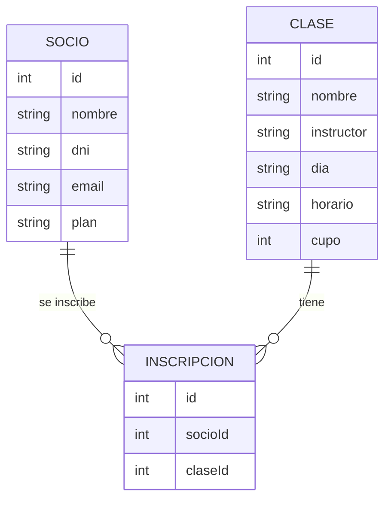

# Gimnasio API

API REST para administrar un gimnasio: los socios se anotan en clases que tienen un cupo limitado. 

Hecha con Node.js, Express, Zod y Sequelize (SQLite), y documentada con Swagger.

## Entidades

- **Socio:** tiene nombre, DNI, email y un plan (mensual, trimestral o anual).
- **Clase:** tiene nombre, instructor, día, horario y cupo (la cantidad máxima de socios).
- **Inscripción:** anota a un socio en una clase (guarda `socioId` y `claseId`).

Socios y clases tienen CRUD completo. Las inscripciones se pueden listar, ver, crear y eliminar.

## Cómo se relacionan

Un socio puede estar anotado en varias clases y una clase tiene varios socios. Por eso la inscripción funciona como tabla intermedia: cada socio tiene muchas inscripciones y cada clase también.



## Reglas de negocio

Están en los casos de uso:

- No se puede crear ni modificar un socio con un DNI que ya existe (409).
- Para inscribir, el socio y la clase tienen que existir (404).
- Un socio no puede anotarse dos veces en la misma clase (409).
- No se puede inscribir si la clase ya está llena (409).
- Si se borra un socio o una clase, se borran también sus inscripciones.

## Cómo está armado el proyecto

Cada pedido pasa por estas capas:

```
ruta → validación (Zod) → controlador → caso de uso → DAO → datos
```

- `routes/`: define las URL y valida los datos que llegan.
- `controllers/`: arma la respuesta HTTP.
- `usecases/`: tiene las reglas de negocio.
- `dao/`: guarda y busca los datos. Hay una versión en memoria (`memory/`) y otra con Sequelize (`sequelize/`), con los mismos métodos.
- `container/`: crea todo y conecta las piezas entre sí.
- `schemas/`, `middlewares/`, `errors/` y `config/`: validaciones, manejo de errores, configuración y conexión a la base (`config/database.js`).
- `listeners/` y `notifiers/`: el evento y su notificación.
- `docs/`: la documentación de Swagger.

`index.js` solo arranca el servidor. Los errores salen siempre con el mismo formato: `{ "error": { "code", "message", "details" } }`.

## Cómo instalar y ejecutar

```
npm install
copy .env.example .env
npm run dev
```

El servidor queda en `http://localhost:3000`

## Variables de entorno

El archivo `.env` no se sube al repo: se crea copiando `.env.example`.

- `PORT`: puerto del servidor (por defecto 3000).
- `PERSISTENCE_TYPE`: dónde se guardan los datos, `memory` o `sequelize` (por defecto `memory`).
- `DB_STORAGE`: archivo de la base SQLite, solo si se usa `sequelize` (por defecto `./database.sqlite`).

## Cómo cambiar de persistencia

Hay que cambiar `PERSISTENCE_TYPE` en el `.env` y reiniciar el servidor:

- Con `memory` los datos se guardan en arrays y se pierden al apagar el servidor.
- Con `sequelize` se guardan en SQLite y se mantienen. Las tablas se crean solas al arrancar. Para empezar de cero, se apaga el servidor y se borra `database.sqlite`.

No hace falta tocar rutas, controladores ni casos de uso, porque `dao/daoFactory.js` es el que elige qué DAO usar. Los dos modos responden igual.

## Documentación de la API

Está en Swagger, en **http://localhost:3000/api-docs**. Ahí se ven todos los endpoints con sus ejemplos y errores, y se pueden probar con "Try it out" en los dos modos de persistencia.

## Evento

Cuando se crea una inscripción, el caso de uso emite el evento `inscripcion.creada`. Un listener (`listeners/registerInscripcionListeners.js`) lo escucha y manda un aviso por consola usando un notificador (`notifiers/consoleNotifier.js`).

El caso de uso no sabe quién escucha, así que se puede cambiar la forma de avisar tocando solo el notificador. Si la notificación falla, el listener atrapa el error y la inscripción se guarda igual.

## Pruebas

En `pruebas.http` están las pruebas de todos los endpoints y de los errores 400, 404 y 409. Se corren con la extensión REST Client de VS Code, reiniciando antes el servidor para que los ids arranquen en 1.